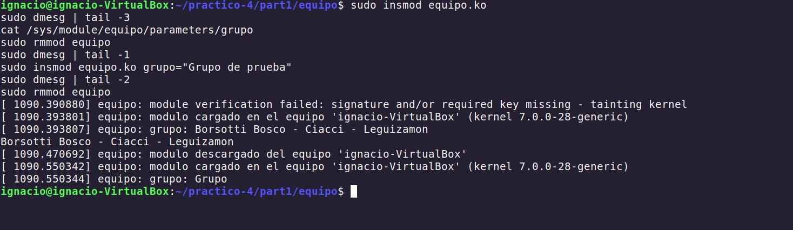
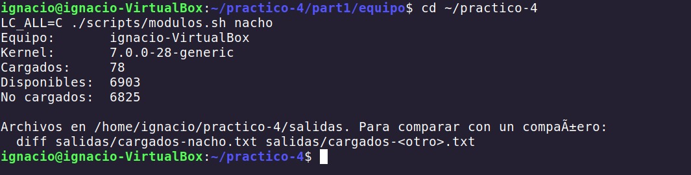
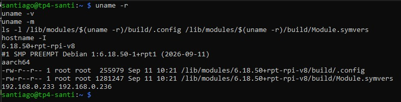
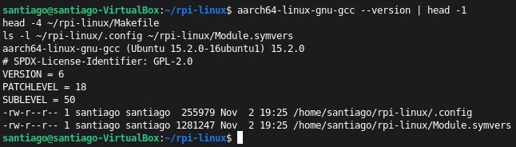
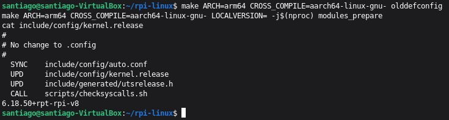
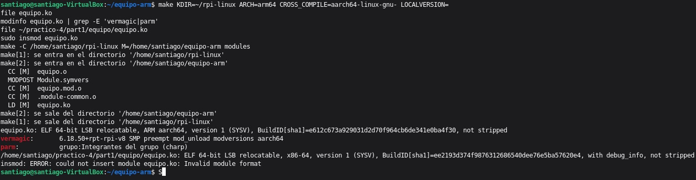
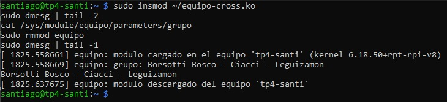

# Procedimiento

Este documento registra paso a paso lo que fuimos haciendo, con las capturas que
verifican cada resultado. Está pensado para leerse en orden.

Las partes siguen la numeración de [`GUIA.md`](GUIA.md), donde están la teoría y los
comandos. Los requisitos del trabajo están en [`CONSIGNA.md`](CONSIGNA.md).

| Parte | Tema | Código |
|---|---|---|
| 1 | Preparar el entorno | — |
| 2 | Mi primer módulo | `part1/module/` |
| 3 | Firmar el módulo | `scripts/crear-clave.sh`, `scripts/firmar.sh` |
| 4 | Nuestro propio módulo | `part1/equipo/` |
| 5 | Los módulos de cada máquina | `scripts/modulos.sh`, `salidas/` |
| 6 | Syscalls y file descriptors | `part1/syscalls/` |
| 7 | Segmentation fault | `part1/segfault/` |
| 8 | Secure Boot y el parche de Microsoft | — |
| 9 | Desafío #2 | — |
| 10 | Desafío #1 | `desafio1/hola/` |
| 11 | La Raspberry Pi: compilación nativa y cruzada | `part1/module/`, `part1/equipo/` |

## Las máquinas

Usamos cuatro máquinas distintas, y eso es justamente lo que permite comparar:

| Máquina | Quién | Tipo | Kernel | Secure Boot |
|---|---|---|---|---|
| `santiago-VirtualBox` | Santiago | VM VirtualBox, Ubuntu 26.04, arranque BIOS | 7.0.0-38-generic | no (sin UEFI) |
| `ignacio-VirtualBox` | Ignacio | VM VirtualBox, Ubuntu 26.04 | 7.0.0-28-generic | no |
| `nico-HP-Laptop-15-ef2xxx` | Nicolás | Notebook HP real (AMD Ryzen), Ubuntu 26.04 | 7.0.0-38-generic | **sí, activo** |
| `tp4-santi` | Santiago | Raspberry Pi, Debian 13 (Raspberry Pi OS), aarch64 | 6.18.50+rpt-rpi-v8 | no |

Salvo que se indique otra cosa, las capturas de las Partes 1 a 3 y 5 a 10 son de la VM
de Santiago.

---

# Parte 1: preparar el entorno

```bash
sudo apt update
sudo apt-get install build-essential checkinstall bison flex libncurses-dev \
     libssl-dev libelf-dev bc linux-source linux-headers-$(uname -r) strace git
```


| Dato | Valor |
|---|---|
| Distribución | Ubuntu 26.04 |
| Kernel (`uname -r`) | 7.0.0-38-generic |
| gcc | 15.2.0 (Ubuntu 15.2.0-16ubuntu1) |
| Headers | `/lib/modules/7.0.0-38-generic/build` existe |
| Fuente del kernel | `/usr/src/linux-source-7.0.0.tar.bz2` |
| Secure Boot | `EFI variables are not supported on this system`: la VM arranca por BIOS (legacy), no por UEFI |

En `/usr/src/` se ven headers de varias versiones (29, 34 y 38): cada actualización de
kernel instala los suyos. Lo que importa es que estén los de la versión que corre.

En la notebook de Nicolás, con Ubuntu instalado de verdad, `mokutil --sb-state` daba
`SecureBoot enabled`. Por eso fue la única máquina donde hubo que firmar (Parte 3).

---

# Parte 2: mi primer módulo

## 2.1 Compilación


`make` le pasa el control a kbuild (`make -C /lib/modules/7.0.0-38-generic/build M=...`)
y genera `mimodulo.ko`, el módulo, más los archivos intermedios: `mimodulo.o`,
`mimodulo.mod.c`, `mimodulo.mod.o`, `Module.symvers` y `modules.order`.

Aparecieron cuatro advertencias, ninguna impide usar el módulo:

| Advertencia | Por qué aparece |
|---|---|
| `the compiler differs from the one used to build the kernel` | Compara el texto de la versión: `x86_64-linux-gnu-gcc` contra `gcc`. Los dos son 15.2.0-16ubuntu1, o sea el mismo compilador |
| `pahole version differs ... You are using: 0` | `pahole` (paquete `dwarves`) no está instalado. Solo se usa para generar BTF |
| `no previous prototype for 'modulo_lin_init'` / `'modulo_lin_clean'` | Las funciones del ejemplo de la cátedra no son `static`, así que quedarían visibles para todo el kernel. Nuestro módulo propio lo corrige |
| `Skipping BTF generation ... due to unavailability of vmlinux` | Los headers de Ubuntu no traen el `vmlinux` completo (Anexo A de la guía) |

## 2.2 Carga


`insmod` respondió `File exists` porque el módulo **ya estaba cargado** de una prueba
anterior. En el `dmesg` se ve la historia completa: `Modulo cargado en el kernel.`
(718 s), `Modulo descargado del kernel.` (810,59 s) y otra vez `Modulo cargado en el
kernel.` (810,62 s). Los avisos de *taint* (`out-of-tree` y `module verification
failed`) solo los imprime el kernel la **primera vez** que se mancha, por eso ya no
aparecen acá (sí se ven en la captura de Ignacio de la Parte 4).

`lsmod` y `/proc/modules` muestran:

```
mimodulo 12288 0 - Live 0xffffffffc03cf000 (OE)
```

| Campo | Valor | Significado |
|---|---|---|
| nombre | `mimodulo` | |
| tamaño | `12288` | 12 KiB (3 páginas de 4 KiB) en memoria del kernel |
| usado por | `0` | nadie lo usa, se puede descargar |
| dependencias | `-` | no depende de otros módulos |
| estado | `Live` | cargado y funcionando |
| dirección | `0xffffffffc03cf000` | en la zona de módulos, arriba de todo del espacio virtual: es memoria del kernel |
| taint | `(OE)` | **O** = *out-of-tree* (no vino con el kernel), **E** = sin firma verificada |

## 2.3 Descarga


`rmmod mimodulo` ejecuta la función de salida, que imprime `Modulo descargado del
kernel.` (2153 s). Después `lsmod | grep mimodulo` no devuelve nada.

## 2.4 modinfo (pregunta 1)


**¿Qué diferencias se pueden observar entre los dos `modinfo`?**

| Campo | `mimodulo.ko` | `des_generic` |
|---|---|---|
| `filename` | `/home/santiago/practico-4/part1/module/mimodulo.ko` | `/lib/modules/7.0.0-38-generic/kernel/crypto/des_generic.ko.zst` (comprimido con zstd) |
| `author` / `description` | Catedra de SdeC / Primer modulo ejemplo | Dag Arne Osvik / DES & Triple DES EDE Cipher Algorithms |
| `alias` | no tiene | 8 alias (`des`, `des3_ede`, `crypto-des`...): los nombres por los que el kernel lo pide con `modprobe` |
| `depends` | vacío | `libdes` |
| `intree` | no aparece | `Y`: se compiló junto con el kernel |
| `sig_id`, `signer`, `sig_key`, `sig_hashalgo` | no aparecen | `PKCS#7`, `Build time autogenerated kernel key`, `3B:E7:D3:...`, `sha512` |
| `vermagic` | `7.0.0-38-generic SMP preempt mod_unload modversions` | igual |
| `license`, `retpoline` | `GPL`, `Y` | `GPL`, `Y` |

En resumen: el módulo del sistema viene **firmado** por la clave que se generó al
compilar el kernel, está marcado como **parte del árbol del kernel** y declara
**alias y dependencias**. El nuestro no tiene nada de eso, y por eso el kernel lo marca
con `O` y `E`.

Lo que **sí** coincide es la `vermagic`: los dos se compilaron para el mismo kernel. Si
no coincidiera, `insmod` lo rechazaría con `Invalid module format`.

---

# Parte 3: firmar el módulo (preguntas 8 y 10)

## 3.1 Clave


`./scripts/crear-clave.sh` generó un par RSA de 2048 bits con `openssl`:

- `~/mok/MOK.priv`: la clave privada, con la que se firma. No se sube al repo (el
  `.gitignore` excluye `MOK.*`) ni se comparte.
- `~/mok/MOK.der`: el certificado con la clave pública, que es lo que se registra.

En la VM de Santiago el último paso (`mokutil --import`) falló con `EFI variables are
not supported on this system`: la VM arranca por BIOS, así que no tiene base de datos de
claves UEFI donde registrar nada. La clave igual sirve para firmar.

## 3.2 Módulo firmado


```bash
../../scripts/firmar.sh mimodulo.ko
```

que corre `sign-file sha256 MOK.priv MOK.der mimodulo.ko`. Después, `modinfo` muestra:

```
signer:         SdeC TP4 santiago-VirtualBox module signing key
sig_key:        32:F5:64:DA:5F:F4:D7:D3:BC:B1:70:75:7D:5F:3B:D1:C1:79:23:B6
sig_hashalgo:   sha256
```

Sin embargo, al cargarlo, `/proc/modules` sigue mostrando **`(OE)`**. La firma está,
pero el kernel **no conoce esa clave** (no está en ninguno de sus *keyrings*), así que no
la puede verificar y lo trata igual que a un módulo sin firmar. **Firmar no alcanza: la
clave tiene que estar registrada en la máquina.**

**En la notebook de Nicolás (Secure Boot activo)** se hizo el proceso completo:

1. Sin firmar, `insmod` fallaba con `insmod: ERROR: could not insert module mimodulo.ko:
   Key was rejected by service`. Con Secure Boot, Ubuntu activa el *lockdown* del kernel
   y lockdown exige módulos firmados con una clave de confianza.
2. `./scripts/crear-clave.sh` creó la clave y `mokutil --import` dejó pedido el registro
   con una contraseña de un solo uso.
3. Al reiniciar, en el **MOK Manager** (la pantalla azul de shim): *Enroll MOK →
   Continue → Yes →* contraseña *→ Reboot*. A partir de ahí la clave está en el keyring
   `.platform` del kernel. `mokutil --test-key ~/mok/MOK.der` responde `is already
   enrolled`.
4. `make firmar` compiló y firmó el módulo `equipo`.
5. `insmod` funcionó con Secure Boot activo. En su `dmesg` (captura
   [`P4-02-carga-descarga-nico`](capturas/P4-02-carga-descarga-nico.png)) aparece
   `loading out-of-tree module taints kernel` pero **no** `module verification failed`:
   el kernel verificó la firma con nuestra clave.

**¿Se animan a firmar un módulo y documentar el proceso?**

Sí, son los pasos de arriba. El resultado se ve comparando las tres máquinas x86:

| Máquina | Firmado | Clave registrada | Resultado |
|---|---|---|---|
| VM de Ignacio | no | — | carga, pero `module verification failed` y taint `E` (no hay Secure Boot) |
| VM de Santiago | sí | no (sin UEFI) | carga, pero sigue con taint `E`: firma que nadie puede verificar |
| Notebook de Nicolás | sí | sí (MOK) | carga **con Secure Boot activo**, sin `verification failed` |

## 3.3 En la máquina de un compañero

**¿Qué pasa si mi compañero con Secure Boot habilitado intenta cargar un módulo firmado
por mí?**

No lo carga. Aunque el módulo tenga una firma válida, el kernel de mi compañero la
verifica contra **sus** claves (las de Canonical, la `db` de su firmware y **sus**
MOK). Mi clave no está ahí, así que el resultado es el mismo que con un módulo sin
firmar: `Key was rejected by service`. Es lo mismo que vimos en la VM de Santiago: firma
presente, clave desconocida.

Además, antes de mirar la firma el kernel compara la `vermagic`: si mi compañero tiene
otra versión de kernel, falla antes con `Invalid module format`. Por ejemplo, un `.ko`
compilado en la VM de Santiago (7.0.0-38) no sirve en la de Ignacio (7.0.0-28).

Para que lo acepte, mi compañero tendría que importar **mi certificado público**
(`MOK.der`, nunca la `.priv`) con `sudo mokutil --import MOK.der` y confirmarlo en su
MOK Manager al reiniciar. Que haga falta estar frente a la máquina y reiniciar es a
propósito: un programa con permisos de root no puede agregar una clave de confianza sin
que el dueño se entere.

---

# Parte 4: nuestro propio módulo (pregunta 9)


`make firmar` compila `equipo.ko` y lo firma. Esta vez no hay advertencias de
prototipos, porque las funciones son `static`. `modinfo` muestra los datos que
declaramos en el código (`version: 1.0`, `author: Borsotti Bosco, Ciacci, Leguizamon`,
`description: TP4: imprime el nombre del equipo en el log del kernel`) y la firma.

Cada integrante lo compiló, cargó y descargó en su máquina. En cada `dmesg` aparece un
hostname distinto, leído con `utsname()->nodename` directamente de la memoria del
kernel.

**Santiago** (VM):


**Nicolás** (notebook con Secure Boot, módulo firmado):


**Ignacio** (VM):



| Máquina | Mensaje al cargar | Taint |
|---|---|---|
| `santiago-VirtualBox` | `equipo: modulo cargado en el equipo 'santiago-VirtualBox' (kernel 7.0.0-38-generic)` | ya estaba manchado por pruebas anteriores |
| `nico-HP-Laptop-15-ef2xxx` | `equipo: modulo cargado en el equipo 'nico-HP-Laptop-15-ef2xxx' (kernel 7.0.0-38-generic)` | solo `out-of-tree`: la firma se verificó |
| `ignacio-VirtualBox` | `equipo: modulo cargado en el equipo 'ignacio-VirtualBox' (kernel 7.0.0-28-generic)` | `module verification failed`: sin firma, pero sin Secure Boot carga igual |

En los tres casos:

- `cat /sys/module/equipo/parameters/grupo` devuelve `Borsotti Bosco - Ciacci -
  Leguizamon`: el parámetro del módulo queda publicado en `/sys`.
- Al descargar aparece `equipo: modulo descargado del equipo '<hostname>'`.
- Al recargarlo con `grupo="Grupo de prueba"` el mensaje cambia. En la VM de Ignacio
  salió solo `Grupo`: el valor se cortó en el primer espacio. Para el kernel, los
  parámetros se separan por espacios, y un valor con espacios tiene que llegarle entre
  comillas (`grupo='"Grupo de prueba"'`).

---

# Parte 5: los módulos de cada máquina (preguntas 2, 3 y 4)

## 5.1 Cargados y disponibles

Cada uno corrió `./scripts/modulos.sh <nombre>` en su máquina:




| Integrante | Equipo | Kernel | Cargados | Disponibles | No cargados |
|---|---|---|---|---|---|
| Santiago | `santiago-VirtualBox` (VM) | 7.0.0-38-generic | 58 | 6903 | 6845 |
| Nicolás | `nico-HP-Laptop-15-ef2xxx` (notebook) | 7.0.0-38-generic | 158 | 6903 | 6745 |
| Ignacio | `ignacio-VirtualBox` (VM) | 7.0.0-28-generic | 78 | 6903 | 6825 |

Los archivos están en `salidas/`: `cargados-*.txt`, `disponibles-*.txt`,
`no-cargados-*.txt` y `resumen-*.txt`. Los `diff` entre las tres máquinas están en
`salidas/diff-santi-nico.txt`, `salidas/diff-santi-nacho.txt` y
`salidas/diff-nico-nacho.txt`.

| Comparación | Solo el primero (`<`) | Solo el segundo (`>`) |
|---|---|---|
| Santiago vs. Nicolás | 18 | 118 |
| Santiago vs. Ignacio | 4 | 24 |
| Nicolás vs. Ignacio | 116 | 36 |

Hay **37 módulos cargados en las tres máquinas**: los genéricos que carga cualquier
Ubuntu (audio base `snd`, `snd_pcm`, `snd_timer`; `video`, `wmi`, `ttm`; `autofs4`,
`binfmt_misc`, `msr`, `joydev`, `parport`, `lp`; cifrado acelerado `aesni_intel` y
`ghash_clmulni_intel`; `intel_rapl_*`; etc.).

Parte del diff entre Santiago y Nicolás:

```diff
< e1000
< snd_intel8x0
< vboxguest
< vboxsf
< vmwgfx
---
> amdgpu
> btusb
> hp_wmi
> k10temp
> kvm_amd
> nvme
> rtw88_8821ce
> snd_sof_amd_renoir
> uvcvideo
```

**¿Qué drivers/módulos están cargados en sus PC? Expliquen las diferencias.**

Las tres máquinas tienen **los mismos 6903 módulos disponibles**, porque es el mismo
Ubuntu, pero cada kernel carga solo los que necesita **el hardware que detecta**:

- **Las VM (Santiago e Ignacio)** cargan drivers del **hardware que emula VirtualBox**:
  `vmwgfx` (placa de video VMware SVGA II), `e1000` (placa de red Intel PRO/1000),
  `snd_intel8x0` y `snd_ac97_codec` (audio AC'97), `ahci`/`pata_acpi` (controladores de
  disco), `psmouse`, y los propios de VirtualBox: `vboxguest` (integración con el host)
  y `vboxsf` (carpetas compartidas). También algunos `intel_pmc_*`/`intel_vsec`, porque
  la PC donde corren las VM tiene un Intel i9-14900HX.
- **La notebook de Nicolás** carga drivers de **hardware real**, por eso tiene casi el
  triple:
  - Video AMD: `amdgpu`, `gpu_sched`, `drm_display_helper`.
  - Procesador AMD Ryzen: `kvm_amd`, `k10temp` (temperatura), `amd_pmc`, `ccp`.
  - Wi-Fi Realtek: `rtw88_8821ce`, `rtw88_pci`, `rtw88_core`, más `mac80211` y
    `cfg80211`.
  - Bluetooth: `bluetooth`, `btusb`, `btrtl`, `btintel`, `btmtk`.
  - Disco SSD: `nvme`, `nvme_core`.
  - Cámara: `uvcvideo`, `videodev`, `videobuf2_*`.
  - Audio AMD: decenas de `snd_sof_amd_*`, `snd_acp*`, `snd_hda_*`, `soundwire_*`.
  - Propios de HP: `hp_wmi`, `hp_bioscfg`, `wireless_hotkey`.
  - Pantalla táctil y touchpad: `i2c_hid`, `hid_multitouch`.
  - Cifrado de disco: `dm_crypt`.
- **Entre las dos VM** la diferencia es chica (28 módulos). Ignacio tiene de más
  `btrfs`, los `raid0/1/10/456` con sus `async_*`, `x_tables`/`ip_tables` y `vga16fb`:
  depende de cómo se instaló cada Ubuntu y qué servicios corren. Santiago tiene de más
  `usbhid`, `hid` y `cpuid`. Además, Ignacio tiene otra versión de kernel (7.0.0-28), así
  que su lista de disponibles no es idéntica a la de Santiago, aunque tenga la misma
  cantidad.

**¿Cuáles no están cargados pero están disponibles? ¿Qué pasa cuando el driver de un
dispositivo no está disponible?**

Son los de `salidas/no-cargados-*.txt`: entre 6745 y 6845 según la máquina, o sea
**más del 97 % de los módulos instalados no se usan**. Están para cuando aparezca el
hardware correspondiente. Por ejemplo, en las tres máquinas están disponibles pero no
cargados `iwlwifi` (Wi-Fi Intel), `i915` (video Intel), `nouveau` (video NVIDIA) y
`e1000e`. Si mañana se conecta un dispositivo que los necesita, udev los carga solo.

El mecanismo:

1. Al detectar un dispositivo, el kernel emite un *uevent* con su `MODALIAS` (IDs de
   fabricante y modelo).
2. udev busca ese alias en `/lib/modules/$(uname -r)/modules.alias` (los `alias:` que
   vimos en `modinfo des_generic`) y corre `modprobe` con el módulo que coincida.
3. **Si no hay ningún módulo para ese alias**, el dispositivo aparece en `lspci` o
   `lsusb`, pero **sin** la línea `Kernel driver in use`, y no funciona: no aparece la
   interfaz de red, no hay sonido, la pantalla queda en un modo genérico, etc.
4. Si el módulo existe pero le falta el *firmware* del dispositivo, `dmesg` muestra
   `failed to load firmware`.

## 5.2 Drivers de cada dispositivo


`lspci -k` en la VM de Santiago muestra el hardware emulado por VirtualBox y el driver
que maneja cada uno:

| Dispositivo | Driver en uso |
|---|---|
| Intel 82371AB PIIX4 IDE | `ata_piix` |
| VMware SVGA II Adapter | `vmwgfx` |
| Intel 82540EM Gigabit Ethernet | `e1000` |
| VirtualBox Guest Service | `vboxguest` |
| Intel 82801AA AC'97 Audio | `snd_intel8x0` |
| Apple KeyLargo USB (OHCI) | `ohci-pci` |
| Intel 82371AB PIIX4 ACPI | `piix4_smbus` |
| Intel 82801FB USB2 EHCI | `ehci-pci` |
| Intel 82801HM SATA (AHCI) | `ahci` |

**Todos** tienen driver. El `dmesg | grep -i firmware` solo muestra mensajes de AppArmor
sobre el snap `firmware-updater`: no hay errores de carga de firmware.

## 5.3 hwinfo y hw-probe


`hwinfo --short` lista el hardware por categoría. Se mezcla lo real y lo emulado: la
**CPU** es la del host (`Intel Core i9-14900HX`, 4 núcleos asignados a la VM), pero la
placa de video (`VMware VMWARE0405`), el disco (`VBOX HARDDISK`), la lectora
(`VBOX CD-ROM`), la red (`Intel PRO/1000 MT`) y el audio (AC'97) son dispositivos
virtuales.


`hw-probe -all -upload -check -decode-acpi` revisó hardware, logs, gráficos, memoria,
discos y CPU, y subió el resultado:

**URL de linux-hardware.org:** <https://linux-hardware.org/?probe=9700ce72bb>

`hw-probe` avisa `This is a probe of VM, so its lifetime is limited`: como es una VM, el
reporte queda publicado por un tiempo limitado.

---

# Parte 6: syscalls y file descriptors (preguntas 5 y 6)

## 6.1 strace del hello world


**¿Cómo puede ver una lista de las llamadas al sistema que realiza un simple hello world
en C?**

Con **`strace`**, que intercepta y muestra cada syscall que hace un proceso, con sus
argumentos y su valor de retorno:

```bash
gcc -Wall -o ejemplo_printf ejemplo_printf.c
strace ./ejemplo_printf        # todas las syscalls
strace -tt ./ejemplo_printf    # con la hora de cada una (microsegundos)
strace -c ./ejemplo_printf     # tabla resumen
```

Lo que se ve en la traza:

1. **`execve("./ejemplo_printf", ...)`**: el kernel carga el programa.
2. **Preparación del cargador dinámico**: `brk`, `mmap`,
   `access("/etc/ld.so.preload") = -1 ENOENT` (no existe y está bien),
   `openat("/etc/ld.so.cache")`, `openat("/usr/lib/x86_64-linux-gnu/libc.so.6")`,
   `read(3, "\177ELF...")` (la cabecera ELF de la libc), varios `mmap` para mapearla y
   `mprotect` para dejar partes de solo lectura.
3. **Preparación del hilo**: `arch_prctl(ARCH_SET_FS)`, `set_tid_address`,
   `set_robust_list`, `rseq`, `prlimit64`, `getrandom` (semilla para el *stack
   protector*).
4. **`fstat(1, {st_mode=S_IFCHR, st_rdev=makedev(0x88, 0)})`**: `printf` pregunta qué es
   el stdout. Es un dispositivo de caracteres con número mayor 0x88 = 136, que es una
   pseudoterminal (`/dev/pts/0`).
5. **`write(1, "We can and we must undrestand co"..., 44) = 44`** y **`write(1, "\n", 1)
   = 1`**: los dos `printf`.
6. **`exit_group(0)`**: el `return 0` de `main`.

Con `strace -c`: **35 syscalls en total y 1 error** (el `access` de
`ld.so.preload`). De esas 35, solo **2 son "nuestras"** (los `write`): todo lo demás es
el cargador dinámico trayendo la libc. Con `-tt` se ve que todo el programa tarda unos
2,6 ms (de 12:59:57.836903 a 12:59:57.839548).

`printf` **no es una syscall**: es una función de la libc que arma el texto en un buffer
y después llama a la syscall `write`. Cuando la salida es una terminal, el buffer se
vacía en cada salto de línea, y por eso hay **dos** `write`. Con
`strace -e trace=write ./ejemplo_printf > /dev/null`, la salida ya no es una terminal y
se ve **un solo** `write(1, ..., 45) = 45`: el buffer se vació una vez, al terminar.

## 6.2 copiar_archivo


```
openat(AT_FDCWD, "../testdir/file1", O_RDONLY) = 3
openat(AT_FDCWD, "../testdir/file2", O_WRONLY|O_CREAT, 0751) = 4
read(3, "Hola, soy el archivo de prueba p"..., 512) = 52
write(4, "Hola, soy el archivo de prueba p"..., 52) = 52
read(3, "", 512) = 0
```

- `open` devuelve el **file descriptor libre más chico**: **3** para el de entrada y
  **4** para el de salida, porque 0, 1 y 2 ya son stdin, stdout y stderr.
- El bucle lee hasta 512 bytes y escribe los que leyó (52). El segundo `read` devuelve
  `0`: fin de archivo, y el bucle termina.
- `file2` quedó con permisos `-rwxr-x--x`, que es el `0751` que pide el programa.
- Al compilar, gcc avisa que `main` debería devolver `int` (el ejemplo usa `void
  main`).

## 6.3 File descriptors


- `ls -l /proc/self/fd` muestra los FDs del propio `ls`: 0, 1 y 2 apuntan a
  `/dev/pts/0` (la terminal), y el 3 apunta a `/proc/15926/fd`, que es el directorio que
  `ls` abrió para listarlo.
- `ls -l /proc/$$/fd` muestra los de la shell: además de 0, 1 y 2, bash tiene el **255**
  apuntando a la terminal. Es una copia que guarda para poder restaurar la terminal
  después de redirecciones.
- Las redirecciones funcionan como se espera: `>` crea el archivo y `>>` agrega
  (`archivo.txt` termina con "Texto de prueba" y "Nueva línea"); `>&2` manda el texto
  al FD 2; escribir en `/proc/self/fd/1` es escribir en el stdout.
- Con dos terminales abiertas (`pgrep -a bash` muestra dos bash, 7938 y 15846), el
  `echo "Mensaje enviado a otra terminal" > /dev/pts/1` de la primera **aparece en la
  segunda**. La terminal es un archivo de dispositivo, y escribir en ella es un `write()`
  más: **en Linux todo es un archivo**.

## 6.4 Módulo vs. programa

**¿Qué diferencia existe entre un módulo y un programa?**

| | Programa (`ejemplo_printf`) | Módulo (`mimodulo`, `equipo`) |
|---|---|---|
| Dónde corre | Espacio de usuario, anillo 3 | Espacio del kernel, anillo 0 |
| Empieza | `main()` (lo llama la libc después de `execve`) | la función de `module_init()` (al hacer `insmod`) |
| Termina | `exit_group(0)`: el proceso desaparece | **no termina**: queda residente hasta `rmmod`, que llama a `module_exit()` |
| Cómo imprime | `printf` → `write(1, ...)` → la terminal | `printk`/`pr_info` → *ring buffer* del kernel → `dmesg` |
| Funciones disponibles | libc y syscalls | solo símbolos exportados por el kernel (Parte 9) |
| Memoria | Su propio espacio virtual (direcciones `0x5b0a...`, `0x790d...` en el strace) | Memoria del kernel, compartida (`0xffffffffc03cf000`) |
| Si falla | El kernel lo mata con `SIGSEGV` y el resto sigue (Parte 7) | Falla el kernel: *oops* o *kernel panic* |
| Quién lo puede cargar | Cualquier usuario | Solo root, y con Secure Boot solo si está firmado con una clave de confianza |

Lo más claro que observamos: para imprimir dos líneas, el programa necesitó **35
syscalls**, y el módulo **ninguna**, porque ya está adentro del kernel.

---

# Parte 7: segmentation fault (pregunta 7)


```
Voy a escribir en la dirección (nil)...
Violación de segmento    (`core' generado) ./segv
código de salida: 139

Manejador de SIGSEGV instalado
Voy a escribir en la dirección (nil)...
Recibí la señal 11 (SIGSEGV) al acceder a (nil)
código de salida: 1

segv[15964]: segfault at 0 ip 000063f72b72c35b sp 00007ffdbcd378f0 error 6 in segv[...]
```

**¿Qué es un segmentation fault? ¿Cómo lo maneja el kernel y cómo lo hace un programa?**

Un **segmentation fault** es un acceso a memoria que el proceso no tiene permitido: leer
o escribir una dirección que no está mapeada (como `NULL`), escribir en una página de
solo lectura o ejecutar donde no se puede. `segv.c` escribe en la dirección 0.

**Cómo lo maneja el kernel:**

1. La MMU no encuentra la dirección en las tablas de páginas del proceso y la CPU lanza
   una **excepción de fallo de página** (*page fault*), que salta al kernel.
2. El kernel revisa si la dirección pertenece a alguna zona válida del proceso. Si fuera
   válida pero no estuviera cargada (swap, reserva perezosa), la cargaría y el programa
   seguiría sin enterarse.
3. Como la dirección 0 no es válida, le manda al proceso la señal **`SIGSEGV`** (11), con
   la dirección culpable.
4. Deja constancia en `dmesg`: `segfault at 0 ... error 6`. El `error 6` es la
   combinación de bits *escritura* (2) + *modo usuario* (4), con la página *no presente*
   (bit 0 en 0).
5. La acción por defecto de `SIGSEGV` es terminar el proceso y generar un *core dump*:
   la shell muestra `Violación de segmento ('core' generado)` y el código de salida es
   **139** = 128 + 11.

**Cómo lo maneja un programa:** puede instalar un manejador con `sigaction()`. En
`./segv manejar`, el manejador recibe la señal, informa la dirección (`(nil)`) y termina
con `_exit(1)`: por eso el código de salida es **1** y no 139. No puede "arreglar" el
error y seguir, porque si el manejador retorna, la CPU vuelve a ejecutar la misma
instrucción y falla otra vez.

**Si el que accede mal es un módulo**, no hay a quién mandarle una señal: el fallo es del
propio kernel. Se produce un **oops** (`BUG: kernel NULL pointer dereference`, con los
registros y la pila en `dmesg`), el kernel queda marcado con taint `D`, puede quedar
inestable o entrar directamente en **kernel panic**. Por eso no lo probamos con un
módulo.

---

# Parte 8: Secure Boot y el parche de Microsoft (pregunta 11)

Nota: <https://arstechnica.com/security/2024/08/a-patch-microsoft-spent-2-years-preparing-is-making-a-mess-for-some-linux-users/>

El parche de agosto de 2024 aplicaba una política **SBAT** (*Secure Boot Advanced
Targeting*), que sirve para revocar versiones viejas de shim y GRUB con
vulnerabilidades conocidas. En este caso, la vulnerabilidad era **CVE-2022-2601**, que
permitía saltear Secure Boot desde GRUB.

1. **¿Cuál fue la consecuencia principal del parche de Microsoft sobre GRUB en sistemas
   con arranque dual?**
   El parche no tendría que haberse aplicado en máquinas con arranque dual, pero la
   detección falló. En esas máquinas, el shim/GRUB de distribuciones como Ubuntu,
   Debian, Linux Mint o Zorin quedó revocado y **Linux dejó de arrancar**, con el
   mensaje `Verifying shim SBAT data failed: Security Policy Violation. Something has
   gone seriously wrong: SBAT self-check failed`. Windows seguía funcionando.
2. **¿Qué implicancia tiene desactivar Secure Boot como solución?**
   Linux vuelve a arrancar, pero **se pierde toda la cadena de verificación**: el
   firmware ejecuta cualquier cargador y el kernel acepta módulos sin firmar (como
   vimos en las VM). Queda abierta la puerta a *bootkits* y rootkits que se cargan antes
   que el sistema operativo, que es justo lo que el parche quería evitar. Además, en
   equipos con BitLocker, Windows puede pedir la clave de recuperación. Debería ser algo
   **temporal**: entrar a Linux, borrar la política (`sudo mokutil --set-sbat-policy
   delete`), reiniciar, **volver a activar Secure Boot** y actualizar shim/GRUB.
3. **¿Cuál es el propósito principal del Secure Boot?**
   Garantizar que en el arranque **solo se ejecute software firmado por claves de
   confianza**. Cada etapa verifica la firma de la siguiente antes de ejecutarla
   (firmware → shim → GRUB → kernel → módulos), y así se arma una **cadena de confianza**
   desde el encendido que impide que un malware se instale por debajo del sistema
   operativo.

El `Key was rejected by service` que vimos en la notebook de Nicolás es el **último
eslabón** de esa misma cadena: el kernel aplicando a los módulos la misma regla que el
firmware aplica a GRUB.

---

# Parte 9: Desafío #2

## ¿Cómo empiezan y terminan unos y otros?

Un **programa** empieza en `main()`, corre de arriba a abajo y termina cuando `main`
retorna: en el `strace` se ve `execve` al principio y `exit_group(0)` al final, y el
proceso desaparece.

Un **módulo** empieza con la función registrada en `module_init()`, que registra lo que
el módulo ofrece y **retorna enseguida** (con `0` si todo salió bien). El código queda
cargado en el kernel, sin ejecutarse, hasta que alguien lo use o hasta el `rmmod`, que
llama a la función de `module_exit()`. En `equipo` lo vimos: un mensaje al cargar,
ninguno mientras está cargado, y otro al descargar.

## ¿Qué funciones tiene disponible un programa y cuáles un módulo?


- **Un programa** tiene la **libc** (`printf`, `malloc`, `fopen`...) y cualquier
  biblioteca que enlace. Por debajo, la única puerta al kernel son las **syscalls**
  (`write`, `openat`, `mmap`... las que vimos con `strace`).
- **Un módulo** no tiene libc. Solo puede usar los **símbolos que exporta el kernel**
  con `EXPORT_SYMBOL` o `EXPORT_SYMBOL_GPL`: `printk`, `kmalloc`, `utsname`...

Lo que se ve en la captura:

- `/proc/kallsyms` tiene **278 525 símbolos**: todos los que conoce el kernel, incluidos
  los de los módulos cargados.
- `printk` en kernels nuevos se llama `_printk`: `ffffffff8b420000 T _printk`. La `T`
  significa código global.
- Con `equipo` cargado, sus símbolos aparecen con `[equipo]`: `d grupo` (la variable del
  parámetro), `t equipo_exit`, `r __param_grupo`, `d __this_module`... Todos en
  direcciones `0xffffffffc09c...` y `0xffffffffc03d...`, la zona de módulos. **No
  aparece `equipo_init`**: como está marcada `__init`, el kernel liberó su memoria
  después de cargar el módulo.
- `Module.symvers` tiene **32 718 símbolos exportados**, que son los que un módulo puede
  usar realmente. Entre ellos, `0xe8213e80 _printk vmlinux EXPORT_SYMBOL`.
- `head -3 /proc/kallsyms` **sin `sudo`** muestra las direcciones en `0000000000000000`:
  la protección `kptr_restrict` esconde las direcciones del kernel a los usuarios
  comunes.

Como todos los módulos comparten ese único espacio de nombres, un nombre global como
`modulo_lin_init` podría chocar con el de otro módulo. Por eso conviene declarar todo
`static`, como en `equipo.c`.

## Espacio de usuario, espacio del kernel y espacio de datos


`cat /proc/self/maps` muestra el mapa de memoria del propio `cat` (en Ubuntu 26.04 es
`/usr/lib/cargo/bin/coreutils/cat`, la versión en Rust):

| Zona | Direcciones | Contenido |
|---|---|---|
| Programa | `576150...`–`5761514e...` | código (`r-xp`), datos de solo lectura y datos (`rw-p`) del ejecutable |
| Heap | `576177f6c000`–`576177fae000` | memoria dinámica (`malloc`) |
| Bibliotecas | `7080b24...`–`7080b2a8...` | `libc.so.6`, `libm`, `libpcre2`, `libselinux`, `libsystemd` y el cargador `ld-linux-x86-64.so.2` |
| Pila | `7ffe9ced1000`–`7ffe9cef2000` | `[stack]` |
| vsyscall | `ffffffffff600000` | una página heredada que el kernel mapea en todos los procesos |

`/proc/modules` muestra, en cambio, módulos en `0xffffffffc0a8c000` (`cfg80211`),
`0xffffffffc0a00000` (`bluetooth`), `0xffffffffc03f4000` (`st`)...

- **Espacio de usuario**: cada proceso tiene su propio espacio virtual en la **mitad
  baja** de las direcciones (hasta `0x00007fff...`), con su código, datos, heap y pila.
  Un proceso no puede ver la memoria de otro: la MMU lo impide.
- **Espacio del kernel**: la **mitad alta** (`0xffff8000...` en adelante), la misma para
  todos los procesos y accesible solo en anillo 0. Los módulos se cargan en una zona
  propia (`0xffffffffc0000000`).
- **Espacio de datos**: las variables de un módulo (como `grupo` en `equipo`) viven en la
  memoria del kernel, **compartida** con todo el kernel y los demás módulos. **Riesgos:**
  un módulo con un error puede pisar estructuras de cualquier otro subsistema, no hay
  protección de memoria entre módulos, y el kernel nunca debe confiar en un puntero que
  le pasa un programa: para copiar datos entre los dos espacios se usan
  `copy_from_user()` y `copy_to_user()`, que verifican la dirección.

## Drivers: contenido de `/dev`


```
crw-rw-rw- 1 root root 1, 3 ... /dev/null
crw-rw-rw- 1 root root 1, 5 ... /dev/zero
crw-rw-rw- 1 root root 1, 9 ... /dev/urandom
crw-rw-rw- 1 root tty  5, 0 ... /dev/tty
brw-rw---- 1 root disk 8, 0 ... /dev/sda
```

- La primera letra es el **tipo**: `c` = dispositivo de **caracteres** (flujo de bytes:
  terminales, `/dev/null`, el mouse) y `b` = de **bloques** (acceso por bloques, con
  caché: el disco `/dev/sda`). También hay directorios (`block`, `bus`, `cpu`, `input`...)
  y enlaces (`cdrom -> sr0`, `fd -> /proc/self/fd`).
- En lugar del tamaño, cada dispositivo tiene **dos números**:
  - **Mayor**: identifica **al driver**. En `/proc/devices` está la tabla: `1 mem`,
    `4 tty`, `5 /dev/tty`, `8` (discos SCSI/SATA), `136 pts`, `189 usb_device`, `226 drm`
    (video), `239 nvme`...
  - **Menor**: identifica **cuál dispositivo** de ese driver. El driver `mem` (mayor 1)
    maneja `null` (menor 3), `zero` (5) y `urandom` (9).
- Cuando un programa hace `open("/dev/...")`, el kernel usa el número mayor para pasarle
  las llamadas (`read`, `write`, `ioctl`) a las funciones del driver correspondiente, que
  es la `struct file_operations` de la presentación.
- Las pruebas: `echo "esto desaparece" > /dev/null` no imprime nada; `head -c 16
  /dev/zero | xxd` da 16 bytes en cero, y `/dev/urandom` da 16 bytes al azar.
- Los archivos de `/dev` los crea **udev** cuando el kernel detecta un dispositivo.

---

# Parte 10: Desafío #1

## ¿Qué es checkinstall y para qué sirve?

Cuando se instala un programa desde el código fuente con `sudo make install`, los
archivos se copian al sistema y **el gestor de paquetes no se entera**: no se puede
desinstalar limpio, ni saber qué instaló, ni pasarlo a otra máquina.

**checkinstall** corre el `make install` (o cualquier comando de instalación), anota
cada archivo que se copia y con eso arma un **paquete `.deb`**. Después se instala, se
lista y se desinstala con `dpkg`/`apt` como cualquier otro paquete, y se puede copiar a
otra máquina.

## Hello world empaquetado


```bash
sudo checkinstall --pkgname=hola-sdc --pkgversion=1.0 --pkgrelease=1 \
     --maintainer="grupo-sdc@unc.edu.ar" --default --install=no --fstrans=no
```

checkinstall corrió `make install`, que copió `hola-sdc` a `/usr/local/bin/`, y generó
`hola-sdc_1.0-1_amd64.deb`. Usamos `--fstrans=no` para que la instalación de prueba se
haga directo en el sistema en vez de en un sistema de archivos temporal.


- `dpkg -c` muestra que el paquete trae un solo archivo: `./usr/local/bin/hola-sdc`
  (14 464 bytes).
- `sudo apt install ./hola-sdc_1.0-1_amd64.deb` lo instala, y `hola-sdc` imprime `Hola
  mundo desde un paquete .deb armado con checkinstall`.
- `dpkg -L hola-sdc` lista lo que instaló.
- `sudo apt remove -y hola-sdc` lo desinstala, y `which hola-sdc` ya no lo encuentra.

## Paquete del stack frame en dos máquinas

Empaquetamos la **calculadora de brecha cambiaria del TP #2** (C + ensamblador):
`calculadora-brecha_1.0-1_amd64.deb`. El paquete instala `/usr/local/bin/calculadora-brecha`
y su `README.md`. Los argumentos son centavos: dólar blue, dólar oficial y pesos a
convertir.

**Máquina 1** (`santiago-VirtualBox`), donde se armó el paquete:


**Máquina 2** (`nico-HP-Laptop-15-ef2xxx`), donde solo se instaló el `.deb`, sin el
código ni el compilador:


```
$ calculadora-brecha 154000 153500 1000000
brecha_centesimas=32
dolares_centavos=649
```

El resultado es **el mismo en las dos máquinas**: una brecha de 0,32 % y USD 6,49 por
$10 000. El aviso de `apt` (`no pudo accederlo el usuario '_apt' ... Permiso denegado`)
es normal cuando se instala un `.deb` local desde la carpeta personal.

El paquete funciona en otra máquina porque el binario solo depende de la libc
(necesita GLIBC 2.38 o más nueva, y las dos tienen Ubuntu 26.04). Si una máquina tuviera
una libc más vieja, habría que recompilarlo allá o declarar la dependencia.

## Evitar cargar módulos sin firmar y evitar rootkits


En la VM de Santiago:

| Comando | Resultado | Qué significa |
|---|---|---|
| `cat /proc/cmdline` | `... ro quiet splash crashkernel=...` | no se pasó ningún parámetro de seguridad extra |
| `cat /sys/kernel/security/lockdown` | `[none] integrity confidentiality` | lockdown **desactivado** (sin Secure Boot) |
| `cat /proc/sys/kernel/modules_disabled` | `0` | se pueden seguir cargando módulos |
| `cat /proc/sys/kernel/tainted` | `12288` | = 4096 (`O`, *out-of-tree*) + 8192 (`E`, sin firma): las marcas que dejaron nuestros módulos |

O sea, en esa VM **cualquier root puede cargar cualquier módulo**. Un rootkit de kernel
es justamente eso: un módulo malicioso que, una vez cargado, está en el anillo 0 y puede
esconder procesos, archivos y conexiones. Las medidas para evitarlo:

| Medida | Cómo |
|---|---|
| **Secure Boot** activo | En el firmware. Ubuntu activa el lockdown y exige módulos firmados (lo vimos en la notebook de Nicolás) |
| Exigir firma aunque no haya Secure Boot | Parámetro de arranque `module.sig_enforce=1`, o kernel compilado con `CONFIG_MODULE_SIG_FORCE=y` |
| **Lockdown** | Parámetro `lockdown=integrity`: además de la firma, bloquea `/dev/mem`, `kexec` sin firmar, etc. |
| Prohibir cargar más módulos | `sysctl kernel.modules_disabled=1` después del arranque (irreversible hasta reiniciar) |
| Bloquear módulos que no se usan | `blacklist` en `/etc/modprobe.d/` |
| Auditar las cargas | Reglas de `auditd` sobre las syscalls `init_module` y `finit_module` |


`rkhunter --check` revisó **183 archivos** (1 sospechoso, a revisar en
`/var/log/rkhunter.log`) y **477 rootkits conocidos**, con **0 posibles rootkits**
encontrados.

## ¿Qué herramientas conocen? ¿Qué técnicas de seguridad incorpora el kernel?

**Herramientas:**

- **rkhunter** y **chkrootkit**: buscan rootkits conocidos, módulos ocultos y binarios del
  sistema modificados.
- **Lynis**: auditoría general de seguridad con recomendaciones.
- **AIDE** / **Tripwire**: guardan el hash de los archivos del sistema y avisan si
  cambian.
- **auditd**: registro de eventos del kernel, por ejemplo cada carga de módulo.
- **Falco**, **Tracee** (basadas en eBPF): detección de comportamiento sospechoso en
  tiempo real.
- **mokutil** y **sign-file**: administrar las claves de confianza y firmar módulos
  (Parte 3).

**Técnicas que trae el kernel:**

- **Firma de módulos** y **lockdown** (Parte 3).
- **KASLR**: el kernel se carga en una dirección al azar en cada arranque.
- **SMEP / SMAP**: el kernel no puede ejecutar ni leer/escribir memoria de usuario por
  accidente.
- **KPTI**: tablas de páginas separadas para usuario y kernel (mitigación de Meltdown).
- **Stack protector**, **FORTIFY_SOURCE**, **CFI**: contra desbordes de pila y saltos a
  código no previsto.
- **`kptr_restrict`** y **`dmesg_restrict`**: esconden direcciones del kernel (lo vimos en
  `/proc/kallsyms` sin `sudo`).
- **LSM**: AppArmor (en Ubuntu, se ven sus mensajes en `dmesg`), SELinux, Yama, Landlock.
- **IMA / EVM**: miden y verifican la integridad de los archivos que se ejecutan.
- **Taint flags**: no impiden nada, pero dejan registro de que se cargó código de
  terceros (el `12288` de arriba).

---

# Parte 11: la Raspberry Pi, compilación nativa y cruzada

Para ver qué cambia en otra arquitectura, Santiago llevó los módulos a una Raspberry Pi 4
(1 GB, Raspberry Pi OS Lite 64-bit, accedida por SSH). Primero se compilaron **en la
propia Raspberry** (11.1) y después **en la VM x86 con un compilador cruzado** (11.2).

## 11.1 Compilación nativa


| Dato | Valor |
|---|---|
| Equipo | `tp4-santi` |
| Sistema | Debian GNU/Linux 13 (trixie), Raspberry Pi OS |
| Kernel | `6.18.50+rpt-rpi-v8`, **aarch64** (ARM de 64 bits) |
| gcc | 14.2.0 (Debian 14.2.0-19) |


```
mimodulo: loading out-of-tree module taints kernel.
Modulo cargado en el kernel.
mimodulo 12288 0 - Live 0xffffffd2325a2000 (O)
vermagic:       6.18.50+rpt-rpi-v8 SMP preempt mod_unload modversions aarch64
```


```
equipo: modulo cargado en el equipo 'tp4-santi' (kernel 6.18.50+rpt-rpi-v8)
equipo: modulo descargado del equipo 'tp4-santi'
```

Diferencias con las máquinas x86:

- **El mismo código fuente** compila y anda sin cambios: el módulo solo usa la API del
  kernel, que es la misma en todas las arquitecturas. Pero el `.ko` es otro: la
  `vermagic` termina en `aarch64`, y un `.ko` de x86 no se puede cargar en la Raspberry
  ni al revés.
- El taint es solo **`(O)`**, sin `E`, y no aparece `module verification failed`. El
  kernel de Raspberry Pi OS se compila **sin verificación de firmas de módulos**, así que
  ni siquiera las mira.
- La dirección (`0xffffffd2325a2000`) también está en la mitad alta, pero la zona de
  módulos de ARM64 está en otro lugar que la de x86 (`0xffffffffc0...`).


## 11.2 Compilación cruzada x86 → ARM

Se compiló el módulo `equipo` en la VM (Ubuntu 26.04, x86-64) con el compilador cruzado
`aarch64-linux-gnu-gcc` y se cargó en la Raspberry. Pasos en la Parte 11 de
[`GUIA.md`](GUIA.md).

### Versión del kernel de la Raspberry



```
6.18.50+rpt-rpi-v8
#1 SMP PREEMPT Debian 1:6.18.50-1+rpt1 (2026-09-11)
aarch64
/lib/modules/6.18.50+rpt-rpi-v8/build/.config
/lib/modules/6.18.50+rpt-rpi-v8/build/Module.symvers
```

El kernel es el **6.18.50** de Raspberry Pi, compilado el 11/09/2026. Su fuente está en
[raspberrypi/linux](https://github.com/raspberrypi/linux), rama `rpi-6.18.y`, que hoy ya
va por la 6.18.60. Buscando en la historia de la rama el último commit con
`SUBLEVEL = 50` en el `Makefile` se encontró
`0c0042cbe1711760cf8e8c213db3c05fca16b81e`, del mismo 11/09/2026. Los headers de Ubuntu
(`linux-headers-$(uname -r)` en la VM) no sirven: son de otro kernel y de otra
arquitectura.

### Toolchain cruzado y fuente del kernel



| Qué | Valor |
|---|---|
| Compilador cruzado | `aarch64-linux-gnu-gcc` 15.2.0 (Ubuntu), paquete `gcc-aarch64-linux-gnu` |
| Fuente del kernel | `~/rpi-linux`, commit `0c0042cbe` (`VERSION = 6`, `PATCHLEVEL = 18`, `SUBLEVEL = 50`), bajado con `git fetch --depth 1` (270 MB) |
| `.config` | Copiado de la Raspberry con `scp` (255 979 bytes) |
| `Module.symvers` | Copiado de la Raspberry con `scp` (1 281 247 bytes) |

El `.config` asegura que el árbol tenga las mismas opciones (SMP, PREEMPT, MODVERSIONS) y
las mismas estructuras que el kernel que corre. El `Module.symvers` trae los CRC de cada
símbolo exportado: con `CONFIG_MODVERSIONS`, el módulo guarda el CRC de `_printk`,
`param_ops_charp`, etc., y el kernel lo compara al cargarlo.

### Preparar el árbol: `modules_prepare`



```
make ARCH=arm64 CROSS_COMPILE=aarch64-linux-gnu- olddefconfig
make ARCH=arm64 CROSS_COMPILE=aarch64-linux-gnu- LOCALVERSION= -j$(nproc) modules_prepare
  UPD     include/config/kernel.release
  UPD     include/generated/utsrelease.h
6.18.50+rpt-rpi-v8
```

`modules_prepare` no compila el kernel: genera los headers que dependen de la
configuración (`utsrelease.h`, `autoconf.h`) y las herramientas de kbuild (`modpost`,
`fixdep`), compiladas para x86 porque corren en la VM.

El primer intento dio `6.18.50-v8` en vez de `6.18.50+rpt-rpi-v8`. El `.config` de
Raspberry Pi OS trae `CONFIG_LOCALVERSION="-v8"`, y el sufijo `+rpt-rpi-v8` lo agrega el
empaquetado de Debian sin guardarlo en el `.config`. Con esa versión la `vermagic` no
habría coincidido y la Raspberry habría rechazado el módulo (`Invalid module format`).
Se corrigió con `./scripts/config --set-str LOCALVERSION "+rpt-rpi-v8"` y se repitió el
paso.

### Compilar en cruzado y probar en la VM



```
$ make KDIR=~/rpi-linux ARCH=arm64 CROSS_COMPILE=aarch64-linux-gnu- LOCALVERSION=
  CC [M]  equipo.o
  MODPOST Module.symvers
  LD [M]  equipo.ko
$ file equipo.ko
equipo.ko: ELF 64-bit LSB relocatable, ARM aarch64, version 1 (SYSV), ...
$ modinfo equipo.ko | grep -E 'vermagic|parm'
vermagic:       6.18.50+rpt-rpi-v8 SMP preempt mod_unload modversions aarch64
parm:           grupo:Integrantes del grupo (charp)
$ file ~/practico-4/part1/equipo/equipo.ko
.../equipo.ko: ELF 64-bit LSB relocatable, x86-64, version 1 (SYSV), ...
$ sudo insmod equipo.ko
insmod: ERROR: could not insert module equipo.ko: Invalid module format
```

- Es el **mismo `Makefile`** de la Parte 4: solo cambia `KDIR` (el árbol del kernel de la
  Raspberry en vez de los headers de Ubuntu) y se agregan `ARCH=arm64` y
  `CROSS_COMPILE=aarch64-linux-gnu-`.
- El mismo `equipo.c` dio dos binarios distintos: **ARM aarch64** (cruzado) y **x86-64**
  (Parte 4).
- La `vermagic` del módulo cruzado es **idéntica** a la del compilado en la Raspberry
  (11.1).
- La VM **no lo puede cargar**: su kernel es x86 y de otra versión.

### Cargarlo en la Raspberry



```
$ sudo insmod ~/equipo-cross.ko
[ 1825.558661] equipo: modulo cargado en el equipo 'tp4-santi' (kernel 6.18.50+rpt-rpi-v8)
[ 1825.558669] equipo: grupo: Borsotti Bosco - Ciacci - Leguizamon
$ cat /sys/module/equipo/parameters/grupo
Borsotti Bosco - Ciacci - Leguizamon
$ sudo rmmod equipo
[ 1825.637675] equipo: modulo descargado del equipo 'tp4-santi'
```

El módulo compilado en `santiago-VirtualBox` (x86) se cargó y corrió en `tp4-santi`
(ARM). Que `insmod` lo aceptara confirma que coincidieron la arquitectura, la versión
(`vermagic`) y los CRC de los símbolos (`Module.symvers`).

| | Nativa (11.1) | Cruzada (11.2) |
|---|---|---|
| Dónde se compila | Raspberry (ARM) | VM (x86-64) |
| Compilador | `gcc` 14.2.0 de Debian, nativo ARM | `aarch64-linux-gnu-gcc` 15.2.0 de Ubuntu |
| Contra qué kernel | Headers del paquete de la Raspberry | Fuente de raspberrypi/linux 6.18.50 + `.config` y `Module.symvers` de la Raspberry |
| `vermagic` | `6.18.50+rpt-rpi-v8 SMP preempt mod_unload modversions aarch64` | Idéntica |
| Resultado en la Raspberry | Carga y descarga | Carga y descarga |

La compilación cruzada es la forma normal de trabajar con sistemas embebidos: el target
suele ser lento, con poca memoria (esta Raspberry tiene 1 GB de RAM y 486 MB libres en la
microSD, donde no entra el fuente del kernel) o directamente sin compilador.

---

# Conclusiones

- **Un módulo no es un programa.** No tiene `main`, ni libc, ni proceso propio: se
  engancha al kernel con `module_init`, queda residente y sale con `module_exit`. Imprime
  con `printk` sin ninguna syscall, mientras que el hello world necesitó 35 syscalls para
  dos líneas.
- **Todo el kernel comparte un mismo espacio.** Los módulos quedan en
  `0xffffffffc0...`, junto al resto del kernel, y solo pueden usar los 32 718 símbolos que
  el kernel exporta. Un error en un programa termina en un `SIGSEGV` prolijo; en un
  módulo, en un *oops* o un *kernel panic*.
- **El hardware decide qué se carga.** Las tres máquinas tienen los mismos 6903 módulos,
  pero las VM cargan 58 y 78 (drivers de hardware emulado como `vmwgfx`, `e1000`,
  `vboxguest`), y la notebook real 158 (`amdgpu`, `rtw88_8821ce`, `nvme`, `btusb`,
  `uvcvideo`...). udev carga cada driver solo, según los IDs del dispositivo.
- **Secure Boot llega hasta los módulos.** Sin Secure Boot el kernel carga cualquier
  módulo y solo lo marca (`E`). Con Secure Boot lo rechaza (`Key was rejected by
  service`) hasta que se firma con una clave **registrada en esa máquina**. Firmar con una
  clave desconocida no alcanza, como vimos en la VM de Santiago, y por eso un módulo
  firmado por un compañero tampoco carga.
- **Desactivar Secure Boot "para que ande"** (como en el caso del parche de Microsoft)
  resuelve el síntoma pero apaga toda la cadena de confianza del arranque y deja abierta
  la puerta a rootkits de kernel.
- **checkinstall** convierte un `make install` en un `.deb`: la calculadora del TP #2 se
  instaló en una segunda máquina sin código ni compilador, y dio el mismo resultado.
- **Un módulo se compila para un kernel exacto.** El mismo `equipo.c` se compiló para
  x86 y para ARM, en la Raspberry y en cruzado desde la VM. Para que el kernel lo acepte
  tienen que coincidir la arquitectura, la versión (`vermagic`) y los CRC de los símbolos
  (`Module.symvers`): por eso para compilar en cruzado hubo que buscar el fuente del
  kernel 6.18.50 de Raspberry Pi y la configuración de la placa, y no alcanzaba con los
  headers de Ubuntu.
